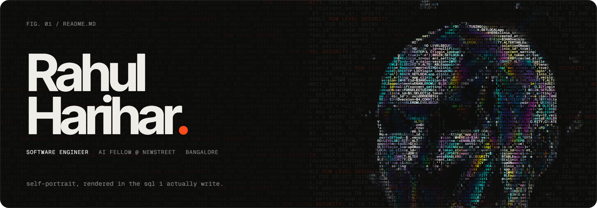
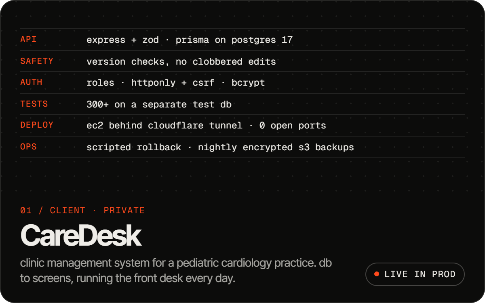
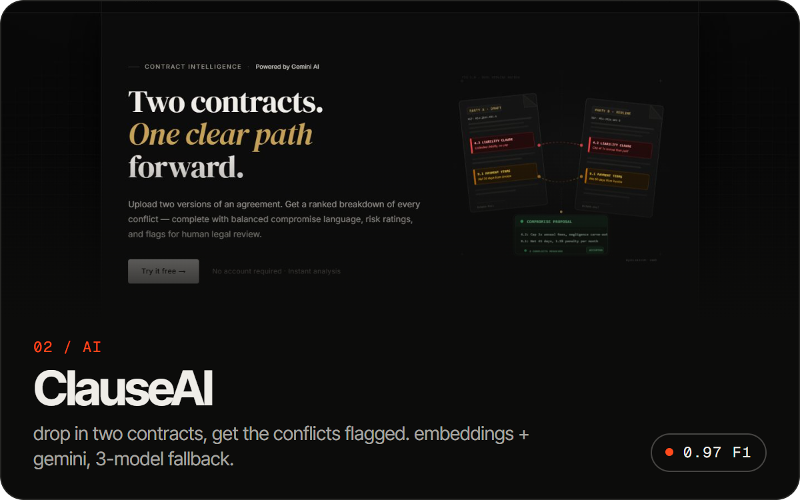
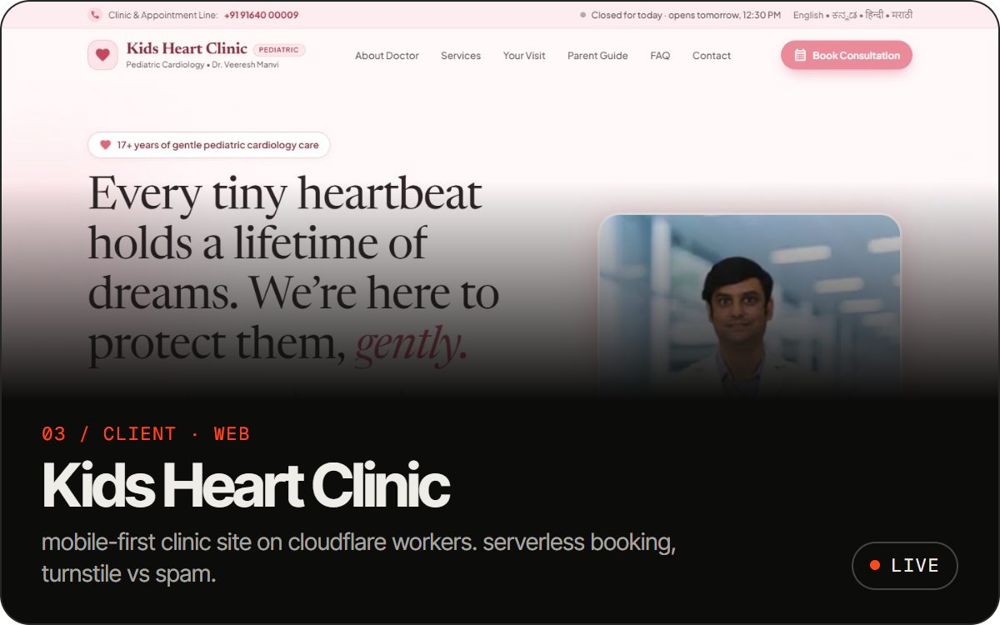
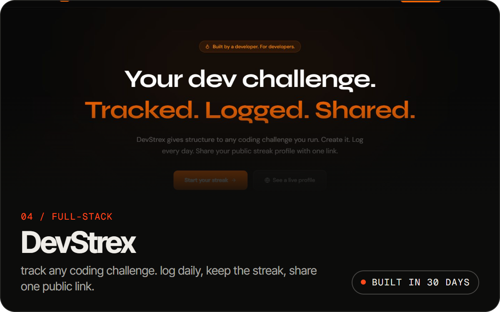
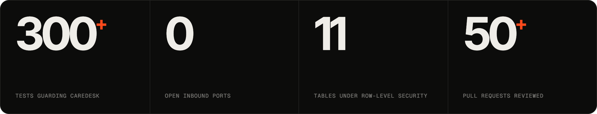
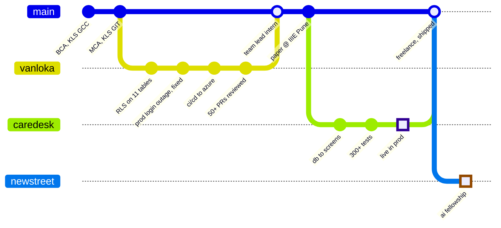

 

i build the unglamorous parts properly. multi-tenant postgres, ci/cd, backups, and ai pipelines that get **evaluated**, not vibed.

right now i'm an **ai fellowship intern at NewStreet Technologies** in bangalore. before that i shipped a clinic system that a real practice runs on every day, and led a team as an intern where i put row-level security on 11 tables, then debugged the prod outage it caused.

[portfolio](https://rahulharihar-portfolio.vercel.app) · [linkedin](https://linkedin.com/in/rahulharihar-) · [x](https://x.com/iamRahul_H) · [resume](https://drive.google.com/file/d/1PXDVzzk4gY6r9zvo2BJ6ytLgrU4nvqlb/view?usp=drive_link) · [work.rahul007@gmail.com](mailto:work.rahul007@gmail.com)

 

## shipped

<table>
  <tr>
    <td width="50%"></td>
    <td width="50%"></td>
  </tr>
  <tr>
    <td width="50%"></td>
    <td width="50%"></td>
  </tr>
</table>

CareDesk is a private client build, so the card shows its spec instead of code. ClauseAI and DevStrex are open: [ClauseAI](https://github.com/RahulHarihar/ClasueAI) · [DevStrex](https://github.com/RahulHarihar/devstrex)

 

 

## the log

## open source

- **merged** · [code-a2z/paisable#46](https://github.com/code-a2z/paisable/pull/46): auth signup validation cleanup, through a full review cycle + CI
- **in review** · [karansinghgit/speaktype#185](https://github.com/karansinghgit/speaktype/pull/185): made the audio player keyboard-accessible with the W3C ARIA slider pattern
- **in review** · [karansinghgit/speaktype#149](https://github.com/karansinghgit/speaktype/pull/149): fixed the formatModelSize threshold + added the missing unit tests

## toolbox

`TypeScript` `Python` `Java` `SQL` · `React` `Node.js` `Express` `Bun` `Zod` · `PostgreSQL` `Prisma` `MongoDB` · `AWS` `Azure` `Cloudflare` `GitHub Actions` · `Vitest` `Supertest` · `Gemini API` `Claude`

## elsewhere

co-authored a paper on grid vs graph clustering algorithms (IIIE Pune, 2026). led my college team to the state-level General Championship, 6 wins and 2 runner-ups. wrote the AI/ML + blockchain problem statements for a national hackathon.

 

<picture>
  <source media="(prefers-color-scheme: dark)" srcset="https://raw.githubusercontent.com/RahulHarihar/RahulHarihar/output/github-snake-dark.svg" />
  <source media="(prefers-color-scheme: light)" srcset="https://raw.githubusercontent.com/RahulHarihar/RahulHarihar/output/github-snake.svg" />
  
</picture>

dms open for databases, infra, ai tooling, or a good bug story.
