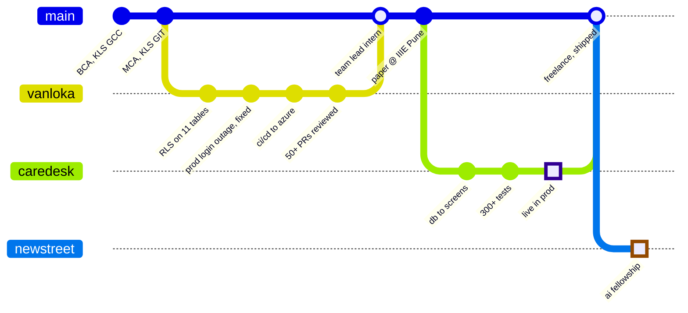

 

i build the parts nobody screenshots: multi-tenant postgres, ci/cd, backups, and ai pipelines that get **evaluated**, not vibed. currently an **ai fellowship intern at NewStreet Technologies**, bangalore.

**[↗ portfolio](https://rahulharihar-portfolio.vercel.app)** · [linkedin](https://linkedin.com/in/rahulharihar-) · [x](https://x.com/iamRahul_H) · [resume](https://drive.google.com/file/d/1PXDVzzk4gY6r9zvo2BJ6ytLgrU4nvqlb/view?usp=drive_link) · [work.rahul007@gmail.com](mailto:work.rahul007@gmail.com)

 

<picture>
  <source media="(prefers-color-scheme: dark)" srcset="assets/title-work-dark.svg" />
  
</picture>

<table>
  <tr>
    <td width="50%"></td>
    <td width="50%"></td>
  </tr>
  <tr>
    <td width="50%"></td>
    <td width="50%"></td>
  </tr>
</table>

CareDesk is a private client build, so its card shows the spec. the rest are open: [ClauseAI source](https://github.com/RahulHarihar/ClasueAI) · [DevStrex source](https://github.com/RahulHarihar/devstrex)

  

<picture>
  <source media="(prefers-color-scheme: dark)" srcset="assets/title-numbers-dark.svg" />
  
</picture>

  

<picture>
  <source media="(prefers-color-scheme: dark)" srcset="assets/title-log-dark.svg" />
  
</picture>

 

<picture>
  <source media="(prefers-color-scheme: dark)" srcset="assets/title-oss-dark.svg" />
  
</picture>

| status | where | what |
|:--|:--|:--|
| **merged** | [code-a2z/paisable#46](https://github.com/code-a2z/paisable/pull/46) | auth signup validation cleanup, through a full review cycle + CI |
| in review | [karansinghgit/speaktype#185](https://github.com/karansinghgit/speaktype/pull/185) | made the audio player keyboard-accessible (W3C ARIA slider pattern) |
| in review | [karansinghgit/speaktype#149](https://github.com/karansinghgit/speaktype/pull/149) | fixed the formatModelSize threshold + added the missing unit tests |

 

<picture>
  <source media="(prefers-color-scheme: dark)" srcset="assets/title-elsewhere-dark.svg" />
  
</picture>

**paper** · co-authored a comparative study of grid vs graph clustering algorithms, IIIE Pune, 2026 
**podiums** · led my college team to the state-level General Championship, 6 wins and 2 runner-ups 
**problem sets** · wrote the AI/ML + blockchain problem statements for a national hackathon 
**toolbox** · `TypeScript` `Python` `SQL` `React` `Node.js` `Express` `Bun` `PostgreSQL` `Prisma` `AWS` `Azure` `Cloudflare` `Vitest` `Gemini API`

 

<picture>
  <source media="(prefers-color-scheme: dark)" srcset="https://raw.githubusercontent.com/RahulHarihar/RahulHarihar/output/github-snake-dark.svg" />
  <source media="(prefers-color-scheme: light)" srcset="https://raw.githubusercontent.com/RahulHarihar/RahulHarihar/output/github-snake.svg" />
  
</picture>

still learning. already shipping. · <a href="https://rahulharihar-portfolio.vercel.app">rahulharihar-portfolio.vercel.app ↗</a>

